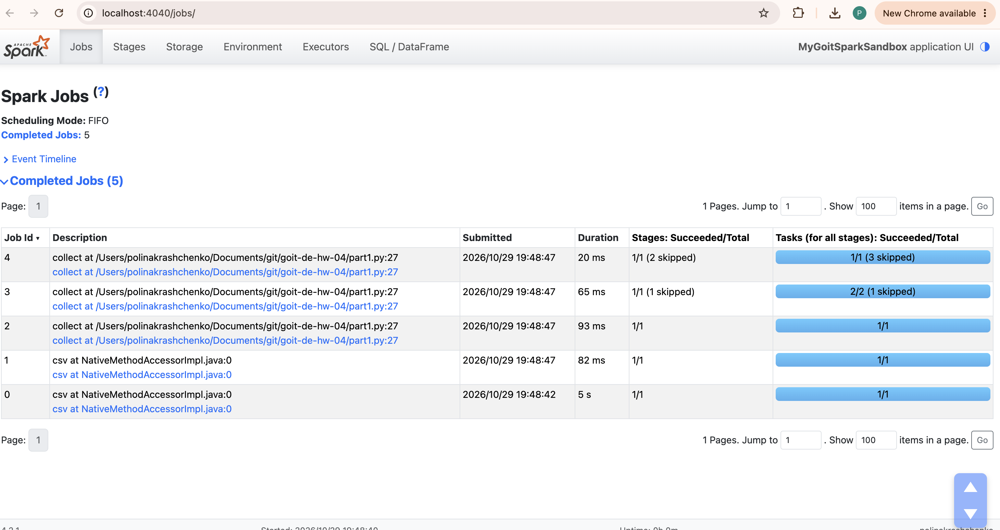
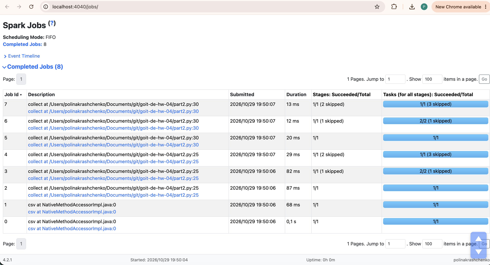
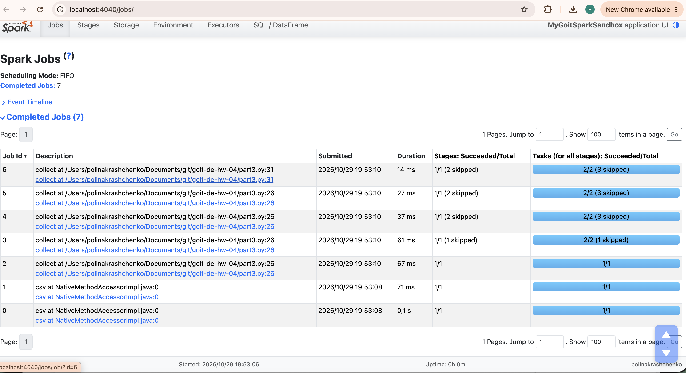

# goit-de-hw-04 — Apache Spark. Оптимізація та SparkUI

Три варіанти однієї програми та аналіз кількості Jobs у SparkUI (http://localhost:4040/jobs/).

## Запуск

```bash
pip install pyspark
python part1.py   # поки програма чекає Enter — відкрити http://localhost:4040/jobs/
python part2.py
python part3.py
```

## Частина 1 — 5 Jobs

- **Job 0–1** — читання CSV: з `header` + `inferSchema` Spark двічі проходить по файлу (перший рядок для заголовка та весь файл для визначення типів).
- **Job 2–4** — `collect()`: Spark ділить план на етапи по межах shuffle (`repartition(2)` та `groupBy`), тож один action дає 3 Jobs.

Фільтр `where("count>2")` — це трансформація, нового Job вона не створює, а просто додається до плану.

## Частина 2 — 8 Jobs

Додано проміжний `collect()` до фільтра `count>2`.

- **Job 0–1** — читання CSV.
- **Job 2–4** — проміжний `collect()`: виконує весь ланцюжок.
- **Job 5–7** — фінальний `collect()`: Spark нічого не пам'ятає між actions, тому весь ланцюжок (`repartition` → `where` → `groupBy` → `where`) перераховується з нуля, і це ще 3 Jobs.

Тож одна додаткова дія дала **+3 Jobs**: кожен action заново запускає всю лінію обчислень.

## Частина 3 — 7 Jobs

Проміжний результат кешується через `.cache()`.

- **Job 0–1** — читання CSV.
- **Job 2–5** — проміжний `collect()`: обчислення результату плюс його збереження в пам'ять.
- **Job 6** — фінальний `collect()`: бере дані з кешу і лише застосовує `where("count>2")`, тому потрібен тільки **1 Job**.

## Навіщо `cache()`

`cache()` зберігає DataFrame у пам'яті після першого action. Наступні actions на ньому (або на трансформаціях від нього) не перераховують ланцюжок з нуля, а читають готові дані. Так зменшується кількість Jobs і час виконання. Кешування ліниве: дані потрапляють у пам'ять лише під час першого action. Після використання пам'ять звільняють через `unpersist()`.

## Скриншоти

### Частина 1 — 5 Jobs


### Частина 2 — 8 Jobs


### Частина 3 — 7 Jobs

